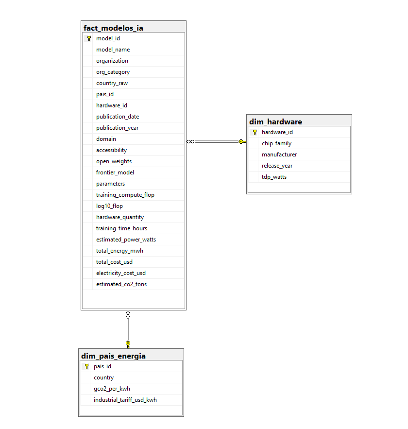
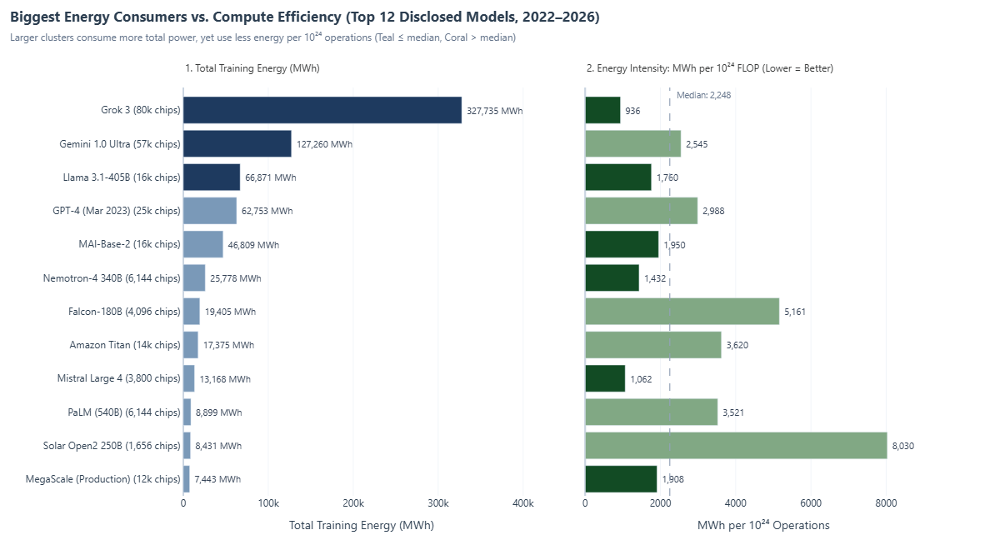
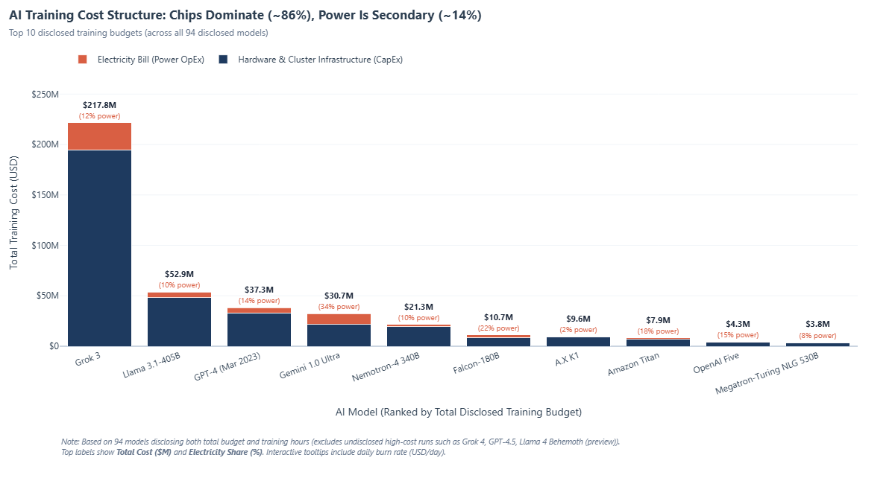
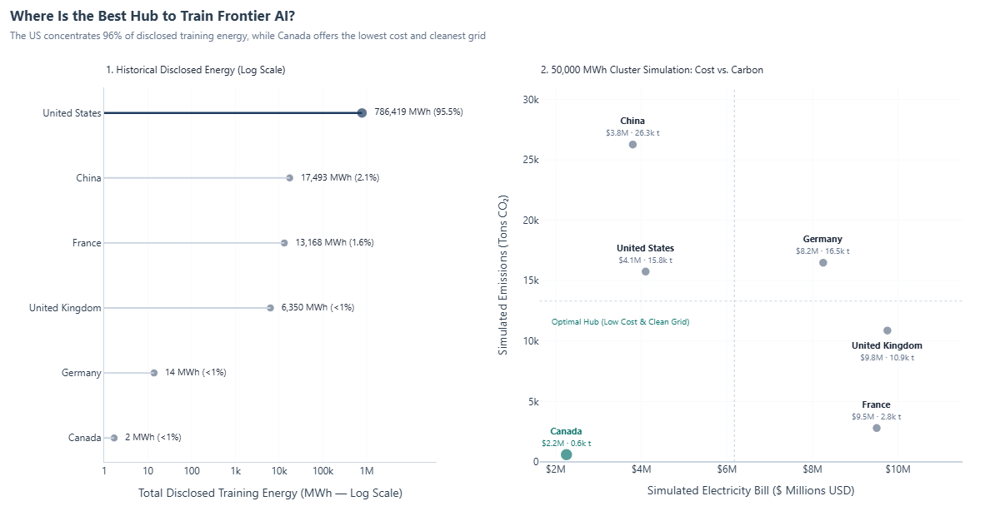
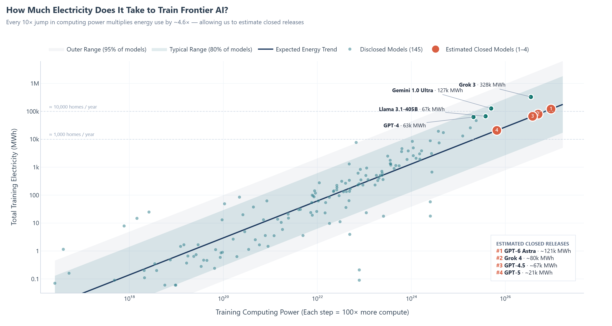
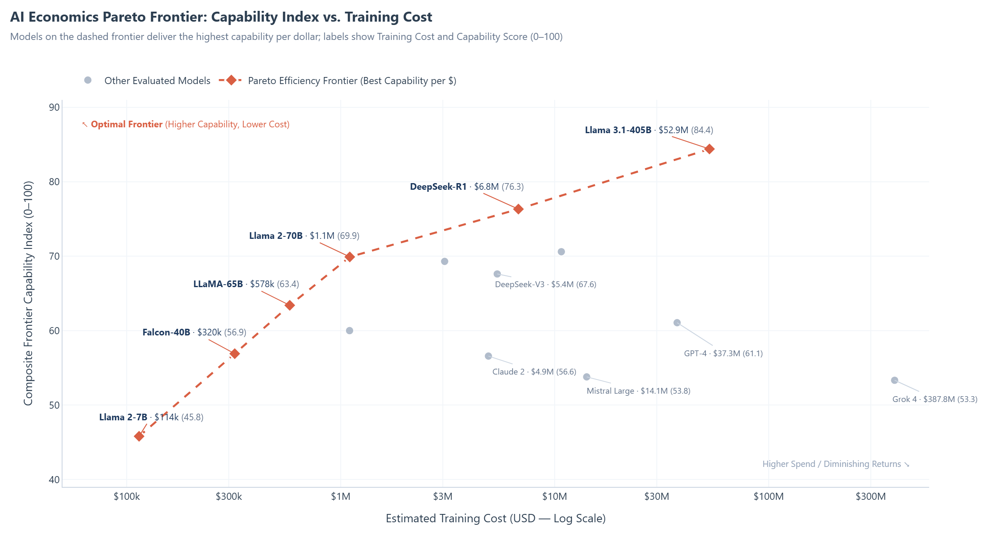

# AI Training Economics, Energy & Environmental Footprint

An end-to-end **Data Engineering, FinOps & ESG Analytics** platform measuring how much it costs—financially, energetically, thermally (water cooling), and environmentally—to train and serve frontier AI models. Built on a **SQL Server Medallion Data Warehouse (`EpochAI_DW`)** and analyzed through **Python** statistical modeling, Pareto optimization, and minimalist **Plotly** visualizations.

## Executive Summary & Key Findings

- **The AI Transparency Gap:** While median carbon emissions per disclosed model surged past **1,900 metric tons of** $\text{CO}_2$ in 2026*, public energy disclosure across the industry dropped from **32% (2022)** to **5% (2026 YTD)** as frontier development shifted toward closed commercial APIs.
- **Facility PUE & Evaporative Water Footprint:** Integrating regional data center Power Usage Effectiveness (`PUE`) and Water Usage Effectiveness (`WUE`) reveals massive secondary environmental loads—for instance, **Grok 3** accounts for **327,735 MWh** of facility-adjusted energy, **589.9 Megaliters** of cooling water, and **103,237 metric tons of** $\text{CO}_2$.
- **Cluster Scale vs. Hardware Efficiency:** Newer accelerators (`NVIDIA H100/H200/B200` and `Google TPUs`) draw more total electricity due to massive cluster sizes, yet require significantly **less energy per** $10^{24}$ **operations** than legacy GPUs.
- **Training Budget Breakdown (~86% CapEx / ~14% OpEx):** Across the Top 10 disclosed frontier training budgets, hardware and cluster infrastructure account for **~86%** of dollar-weighted capital expenditure, whereas pure electricity bills represent **~14%**.
- **Predictive Scaling Laws ($R^2$) & Uncertainty Bounds:** Log-linear OLS regression with **80% and 95% Prediction Intervals** quantifies the hidden electricity demand of undisclosed frontier releases (such as **GPT-6 Astra**, **Grok 4**, **GPT-4.5**, and **GPT-5**) from their reported compute scale (`FLOPs`).
- **Pareto Efficiency Frontier & Geopolitical Site Selection:** Cross-referencing frontier benchmarks (`GPQA Diamond`, `FrontierMath`, `SWE-Bench`, `MMLU`) against training costs identifies Pareto-optimal models (led by **DeepSeek-R1** and the **Llama** family), while regional grid simulations show the **United States concentrates 96%** of historical disclosed energy whereas **Canada** offers the optimal balance of low electricity tariffs and clean hydro/nuclear power.

## Data Architecture & Tech Stack

### 1. SQL Server Medallion Data Warehouse (`EpochAI_DW`)

Raw multi-source datasets are ingested and refined across three governed layers using standardized lowercase `snake_case` naming conventions:

- **Bronze Layer (`data/01_bronze_raw/` & `dbo.stg_*`):** Immutable raw ingestion of Epoch AI Models, ML Hardware (`153` accelerators), Frontier Benchmarks (`534` evaluated models), and Regional Grid Carbon/Water/Tariff telemetry (`7` regions) with UTC audit timestamps (`_ingested_at_utc`) and source lineage (`_source_file`).
- **Silver Layer (`warehouse/02_silver_transform/`):** Normalized Star Schema combining `fact_ai_models` with cleansed, deduplicated dimension tables linked via Foreign Keys:
  - `dim_hardware` & `dim_hardware_specs`: Chip family taxonomy, official GPU/TPU TDP (Watts), BF16/FP8 TFLOPS, memory capacity (`memory_gb`), and unit CapEx (`est_unit_capex_usd`).
  - `dim_country_energy` & `dim_grid_enriched`: Regional grid carbon intensity ($\text{gCO}_2\text{/kWh}$), industrial tariffs ($\text{USD/MWh}$), Water Usage Effectiveness (`wue_liters_kwh`), and facility `default_facility_pue`.
  - `dim_model_benchmarks`: Consolidated scores across `GPQA Diamond`, `FrontierMath`, `SWE-Bench Verified`, `MMLU`, and `WebDev Arena` into a normalized `composite_index` ($0\text{--}100$).
- **Gold Layer (`warehouse/03_gold_marts/vw_models_enriched.sql`):** Unified semantic view computing facility-adjusted energy (`facility_total_energy_mwh`), evaporative water footprint (`water_footprint_megaliters`), PUE-adjusted $\text{CO}_2$ emissions (`pue_adjusted_co2_tons`), CapEx/OpEx splits, and capability ROI (`usd_per_capability_point`, `co2_tons_per_capability_point`).
- **Automated Data Quality Governance (`warehouse/04_tests/data_quality_assertions.sql`):** SQL audit suite enforcing foreign-key integrity, physical bounds (`PUE`, `TDP`), and FinOps cost consistency (`6/6 PASS`).

### Star Schema & Entity-Relationship Model



## Repository Structure

```text
ai-training-economics-and-footprint/
├── analysis/
│   └── eda_ai_energy_economics.ipynb    # Consolidated EDA, OLS scaling, Pareto & TCO analysis (Charts 1–9)
├── assets/
│   ├── diagrama_er_ssms.png             # SQL Server Star Schema ER diagram
│   └── charts/                          # All 9 print-ready minimalist Plotly PNG visualizations
│       ├── chart1_scaling_transparency.png
│       ├── chart2_energy_efficiency.png
│       ├── chart3_cost_structure.png
│       ├── chart4_predictive_scaling.png
│       ├── chart5_geopolitical_grid.png
│       ├── chart6_governance_risk.png
│       ├── chart7_competitive_landscape.png
│       ├── chart8_imputation_uncertainty.png
│       └── chart9_pareto_frontier.png
├── data/
│   ├── 01_bronze_raw/                   # Immutable raw CSVs (Epoch AI, Benchmarks, Grid)
│   └── 02_gold_exports/                 # Exported Gold Mart snapshot (models_enriched_gold.csv)
├── docs/
│   └── methodology_and_sources.md       # Physics equations, FinOps assumptions & data citations
├── pipelines/
│   ├── config.py                        # SQLAlchemy + ODBC Driver 18 connection manager
│   ├── extract_sources.py               # Automated download & staging of raw data sources
│   ├── load_bronze_to_sql.py            # Bronze staging ingestion into SQL Server
│   ├── export_gold_mart.py              # Gold semantic view exporter to CSV
│   └── build_notebooks.py               # Reproducible analytical notebook generator
├── warehouse/
│   ├── 01_ddl/                          # Database & Star Schema DDL scripts
│   ├── 02_silver_transform/             # Dimension & fact table transformations
│   ├── 03_gold_marts/                   # Semantic views (vw_models_enriched.sql) & business queries
│   └── 04_tests/                        # Automated SQL Data Quality assertions
├── .env.example
├── .gitignore
├── LICENSE
├── requirements.txt
└── README.md
```

## Visual Analytics Gallery

### 1. Scaling Laws & The Reporting Transparency Gap (2018–2026*)
Tracks median carbon emissions per model alongside compute growth ($\log_{10}\text{ FLOP}$) and declining industry energy disclosure rates.


### 2. Energy Consumption vs. Compute Efficiency (Top 12 Models)
Compares total training energy (`MWh`) against energy intensity (`MWh` per $10^{24}$ operations) to separate cluster scale from hardware efficiency.


### 3. Training Budget Breakdown: Hardware CapEx (~86%) vs. Electricity OpEx (~14%)
Quantifies capital allocation between hardware/cluster infrastructure CapEx and pure electricity OpEx across the Top 10 disclosed training budgets.


### 4. Predictive Scaling Regression & Estimated Undisclosed Frontier Models
Fits a log-linear scaling model across modern runs ($\ge 10^{21}$ FLOP) with a $\pm 1\text{ SD}$ estimation corridor to project electricity consumption for top undisclosed frontier releases.


### 5. Geopolitical Grid Trade-Off & 50,000 MWh Site Simulation
Contrasts historical national training energy concentration with a 50,000 MWh *what-if* simulation comparing industrial electricity tariffs against grid carbon intensity.


### 6. AI Governance & Risk: Open-Weights vs. Closed Commercial Releases
Examines how the market shift from open-weights (`56%` in 2020 to `35%` in 2026*) to closed commercial API releases drives the environmental reporting gap.


### 7. Competitive Landscape: Top 10 AI Labs (Scale vs. Transparency)
Benchmarks consolidated leading organizations (`Google / DeepMind`, `OpenAI`, `Meta / FAIR`, etc.) by notable model output, peak compute scale, and energy disclosure transparency.


### 8. Physics-Informed Energy Scaling Law & Prediction Uncertainty Bands
Models facility-adjusted energy (`MWh`) against training compute with **80% and 95% Prediction Intervals** and household electricity equivalents (`1,000` to `10,000` homes/year) across disclosed and estimated frontier models.


### 9. AI Economics Pareto Frontier: Capability Index vs. Training Cost
Evaluates frontier models on `Composite_Capability_Index` ($0\text{--}100$) versus estimated training cost (`USD`) to identify the cost-efficiency Pareto frontier.


## Assumptions & Limitations

- **Self-Reporting & Selection Bias:** Disclosed energy figures come primarily from academic labs, open-weights releases, or organizations with favorable efficiency metrics. Closed commercial labs rarely publish power telemetry, meaning estimated figures for undisclosed models represent baseline projections rather than audited consumption.
- **Data Center PUE & Water Cooling (WUE):** Facility energy and evaporative water consumption incorporate regional `default_facility_pue` and `wue_liters_kwh` benchmarks (`dim_grid_enriched`), which vary depending on hyperscale closed-loop cooling versus evaporative cooling towers.
- **CapEx Amortization vs. Spot Pricing:** The ~86% CapEx / ~14% OpEx split reflects full hardware acquisition and cluster allocation costs reported in Epoch AI's training cost estimates rather than short-term cloud spot-instance pricing, and excludes non-training R&D, data curation, and post-deployment inference costs (modeled separately in the 12-month lifecycle TCO simulation).
- **Grid Average vs. Marginal Emissions:** Carbon footprint estimates use regional average grid carbon intensity (`dim_grid_enriched`) and do not account for behind-the-meter renewable Power Purchase Agreements (PPAs) or hourly marginal grid dispatch variations.

## How to Reproduce

### Prerequisites

- **Microsoft SQL Server** (Express, Developer, or Enterprise) + **SQL Server Management Studio (SSMS)**
- **Python 3.10+** with **ODBC Driver 17 or 18 for SQL Server**

### Step-by-Step Setup

1. **Clone & Configure Environment:**

   ```bash
   git clone https://github.com/marceloalmeidapinto1998/ai-training-economics-and-footprint.git
   cd ai-training-economics-and-footprint
   python -m venv .venv
   .venv\Scripts\activate
   pip install -r requirements.txt
   copy .env.example .env
   ```

   Update `.env` with your local SQL Server instance (`DB_SERVER=localhost\SQLEXPRESS`, `DB_NAME=EpochAI_DW`, `DB_DRIVER=ODBC Driver 18 for SQL Server`).

2. **Initialize Base Star Schema & Ingest Bronze Data:**
   Run the DDL scripts in `warehouse/01_ddl/` and `warehouse/02_silver_transform/build_fact_models.sql`, then ingest the multi-source Bronze staging tables:

   ```bash
   python pipelines/extract_sources.py
   python pipelines/load_bronze_to_sql.py
   ```

3. **Build Silver & Gold Layers + Run Data Quality Assertions:**

   ```bash
   sqlcmd -S "localhost\SQLEXPRESS" -d "EpochAI_DW" -E -C -i "warehouse/02_silver_transform/build_dimensions.sql"
   sqlcmd -S "localhost\SQLEXPRESS" -d "EpochAI_DW" -E -C -i "warehouse/02_silver_transform/build_fact_models.sql"
   sqlcmd -S "localhost\SQLEXPRESS" -d "EpochAI_DW" -E -C -i "warehouse/03_gold_marts/vw_models_enriched.sql"
   sqlcmd -S "localhost\SQLEXPRESS" -d "EpochAI_DW" -E -C -i "warehouse/04_tests/data_quality_assertions.sql"
   ```

4. **Export Gold Mart & Execute Analytical Notebook:**

   ```bash
   python pipelines/export_gold_mart.py
   ```

   Open `analysis/eda_ai_energy_economics.ipynb` in VS Code or Jupyter and click **Run All** to reproduce all 9 visualizations and the 12-month lifecycle TCO simulation.

## Data Sources & Methodology

Detailed physics equations, FinOps formulas, and full dataset citations are documented in [docs/methodology_and_sources.md](docs/methodology_and_sources.md).

- **Epoch AI — Notable AI Models & ML Hardware Datasets:** <https://epoch.ai/data/>
- **Epoch AI — Capabilities & Benchmarking Archive:** GPQA Diamond, FrontierMath, SWE-Bench Verified, MMLU & WebDev Arena
- **Ember / Our World in Data (OWID) & US EPA eGRID:** Regional grid carbon intensity factors and industrial electricity tariffs