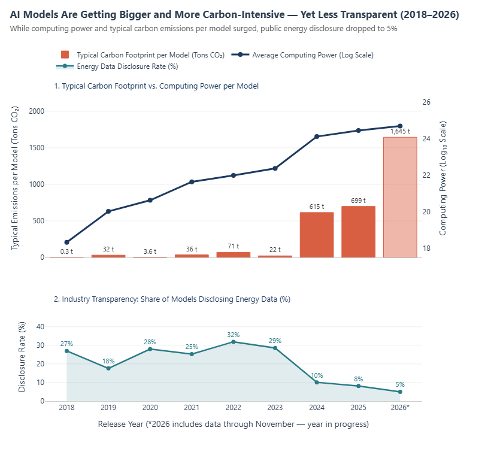
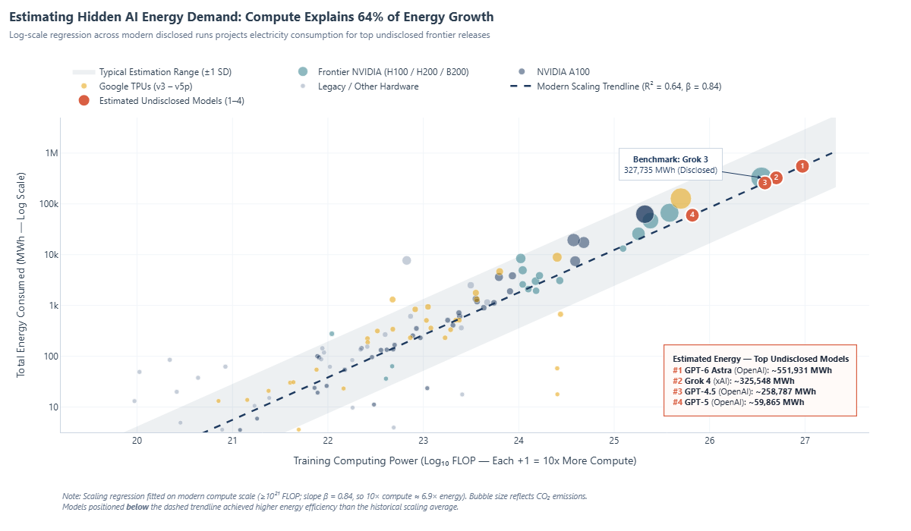
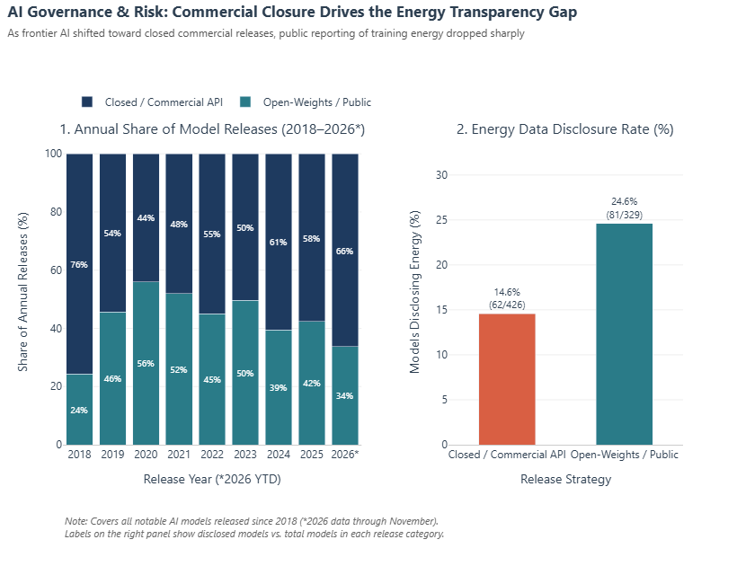
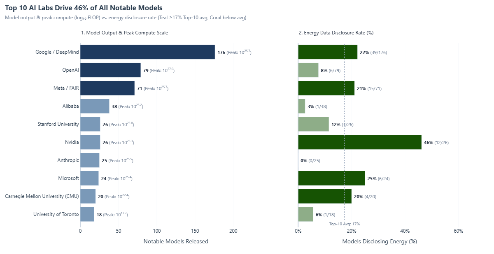

## The Real Cost of Training Frontier AI Models

An end-to-end **FinOps & ESG Analytics** platform measuring how much it costs—financially, energetically, thermally (water cooling), and environmentally—to train and serve frontier AI models. Built on a **SQL Server Data Warehouse** and analyzed through **Python** statistical modeling, Pareto optimization, and **Plotly** visualizations.

### Summary & Key Findings

- **The AI Transparency Gap:** Public energy disclosure across the industry dropped from **32% (2022)** to **5% (2026 YTD)** as frontier development shifted toward closed commercial APIs.
- Training a frontier model takes more than chip power - cooling and grid losses add massive hidden costs. For example, training Grok 3 consumed **327,735 MWh** of electricity (a full year of power for ~32,000 homes), evaporated **589.9 million liters** of water (~235 Olympic pools), and released **103,237 metric tons of** $\text{CO}_2$.
- Newer chips use more total power because they run in massive clusters, yet they deliver more work per unit of energy than older GPUs.
- CapEx represents **~86%** of total training costs, compared to **14%** for power consumption.
- The **US** accounts for the vast majority of disclosed AI power consumption to date.
- **Canada** stands out by combining lower electricity costs with a significantly cleaner power grid.
- Using public data on how much computing power known AI models require, a **forecasting model** estimates the electricity footprint of major undisclosed models like GPT-6 Astra, Grok 4, GPT-4.5, and GPT-5.

### Data Architecture

#### 1. Data Warehouse

Raw multi-source datasets are ingested and refined across three governed layers:

- **Bronze Layer (`data/01_bronze_raw/` & `dbo.stg_*`):** Immutable raw ingestion of Epoch AI Models, ML Hardware (`153` accelerators), Frontier Benchmarks (`534` evaluated models), and Regional Grid Carbon/Water/Tariff telemetry (`7` regions) with UTC audit timestamps (`_ingested_at_utc`) and source lineage (`_source_file`).
- **Silver Layer (`warehouse/02_silver_transform/`):** Normalized Star Schema combining `fact_ai_models` with cleansed, deduplicated dimension tables linked via Foreign Keys:
  - `dim_hardware` & `dim_hardware_specs`: Chip family taxonomy, official GPU/TPU TDP (Watts), BF16/FP8 TFLOPS, memory capacity (`memory_gb`), and unit CapEx (`est_unit_capex_usd`).
  - `dim_country_energy` & `dim_grid_enriched`: Regional grid carbon intensity ($\text{gCO}_2\text{/kWh}$), industrial tariffs ($\text{USD/MWh}$), Water Usage Effectiveness (`wue_liters_kwh`), and facility `default_facility_pue`.
  - `dim_model_benchmarks`: Consolidated scores across `GPQA Diamond`, `FrontierMath`, `SWE-Bench Verified`, `MMLU`, and `WebDev Arena` into a normalized `composite_index` ($0\text{--}100$).
- **Gold Layer (`warehouse/03_gold_marts/vw_models_enriched.sql`):** Unified semantic view computing facility-adjusted energy (`facility_total_energy_mwh`), evaporative water footprint (`water_footprint_megaliters`), PUE-adjusted $\text{CO}_2$ emissions (`pue_adjusted_co2_tons`), CapEx/OpEx splits, and capability ROI (`usd_per_capability_point`, `co2_tons_per_capability_point`).
- **Automated Data Quality Governance (`warehouse/04_tests/data_quality_assertions.sql`):** SQL audit suite enforcing foreign-key integrity, physical bounds (`PUE`, `TDP`), and FinOps cost consistency (`6/6 PASS`).

#### Star Schema & Entity-Relationship Model


### Repository Structure

```text
ai-training-economics-and-footprint/
├── analysis/
│   └── eda_ai_energy_economics.ipynb    # Consolidated EDA, OLS scaling, Pareto & TCO analysis (Charts 1–9)
├── assets/
│   ├── diagrama_er_ssms.png             # SQL Server Star Schema ER diagram
│   └── charts/                          # All 9 print-ready Plotly PNG visualizations
│       ├── chart1_scaling_transparency.png
│       ├── chart2_energy_efficiency.png
│       ├── chart3_cost_structure.png
│       ├── chart4_predictive_scaling.png
│       ├── chart5_geopolitical_grid.png
│       ├── chart6_governance_risk.png
│       ├── chart7_competitive_landscape.png
│       ├── chart8_imputation_uncertainty.png
│       └── chart9_pareto_frontier.png
├── data/
│   ├── 01_bronze_raw/                   # Immutable raw CSVs (Epoch AI, Benchmarks, Grid)
│   └── 02_gold_exports/                 # Exported Gold Mart snapshot (models_enriched_gold.csv)
├── docs/
│   └── methodology_and_sources.md       # Physics equations, FinOps assumptions & data citations
├── pipelines/
│   ├── config.py                        # SQLAlchemy + ODBC Driver 18 connection manager
│   ├── extract_sources.py               # Automated download & staging of raw data sources
│   ├── load_bronze_to_sql.py            # Bronze staging ingestion into SQL Server
│   ├── export_gold_mart.py              # Gold semantic view exporter to CSV
│   └── build_notebooks.py               # Reproducible analytical notebook generator
├── warehouse/
│   ├── 01_ddl/                          # Database & Star Schema DDL scripts
│   ├── 02_silver_transform/             # Dimension & fact table transformations
│   ├── 03_gold_marts/                   # Semantic views (vw_models_enriched.sql) & business queries
│   └── 04_tests/                        # Automated SQL Data Quality assertions
├── .env.example
├── .gitignore
├── LICENSE
├── requirements.txt
└── README.md
```

### What the Data Shows

#### 1. Transparency Gap (2018–2026*)


#### 2. Energy Consumption vs. Compute Efficiency


#### 3. CapEx vs. Electricity costs


#### 4. Estimating Power Use


#### 5. Comparing Countries


#### 6. Open vs. Closed Models


#### 7. Ranking the Top AI Labs on Scale and Transparency


#### 8. Estimating Power Growth


#### 9. Cost vs. Performance: Finding the Most Efficient AI Models


### Assumptions

- Public power figures come mostly from academic labs, open-weights releases, or organizations with favorable efficiency numbers. Because closed commercial labs rarely share power telemetry, figures for undisclosed models are baseline estimates rather than audited totals.
- Total electricity and evaporated water estimates rely on regional averages for facility efficiency and water use. Actual water consumption varies depending on whether a data center uses closed-loop cooling or evaporative cooling towers.
- This cost split is based on full hardware and cluster allocation estimates from Epoch AI - not short-term cloud spot pricing. It covers training runs only, excluding R&D salaries, data preparation, and post-launch inference.
- Emissions estimates use regional average grid carbon intensity. They do not reflect private renewable energy contracts (PPAs) or hour-by-hour fluctuations in the power grid.

### How to Reproduce

#### Prerequisites

- **Microsoft SQL Server** (Express, Developer, or Enterprise) + **SQL Server Management Studio (SSMS)**
- **Python 3.10+** with **ODBC Driver 17 or 18 for SQL Server**

### #Step-by-Step Setup

1. **Clone & Configure Environment:**

   ```bash
   git clone https://github.com/marceloalmeidapinto1998/ai-training-economics-and-footprint.git
   cd ai-training-economics-and-footprint
   python -m venv .venv
   .venv\Scripts\activate
   pip install -r requirements.txt
   copy .env.example .env
   ```

   Update `.env` with your local SQL Server instance (`DB_SERVER=localhost\SQLEXPRESS`, `DB_NAME=EpochAI_DW`, `DB_DRIVER=ODBC Driver 18 for SQL Server`).

2. **Initialize Base Star Schema & Ingest Bronze Data:**
   Run the DDL scripts in `warehouse/01_ddl/` and `warehouse/02_silver_transform/build_fact_models.sql`, then ingest the multi-source Bronze staging tables:

   ```bash
   python pipelines/extract_sources.py
   python pipelines/load_bronze_to_sql.py
   ```

3. **Build Silver & Gold Layers + Run Data Quality Assertions:**

   ```bash
   sqlcmd -S "localhost\SQLEXPRESS" -d "EpochAI_DW" -E -C -i "warehouse/02_silver_transform/build_dimensions.sql"
   sqlcmd -S "localhost\SQLEXPRESS" -d "EpochAI_DW" -E -C -i "warehouse/02_silver_transform/build_fact_models.sql"
   sqlcmd -S "localhost\SQLEXPRESS" -d "EpochAI_DW" -E -C -i "warehouse/03_gold_marts/vw_models_enriched.sql"
   sqlcmd -S "localhost\SQLEXPRESS" -d "EpochAI_DW" -E -C -i "warehouse/04_tests/data_quality_assertions.sql"
   ```

4. **Export Gold Mart & Execute Analytical Notebook:**

   ```bash
   python pipelines/export_gold_mart.py
   ```

   Open `analysis/eda_ai_energy_economics.ipynb` in VS Code or Jupyter and click **Run All** to reproduce all 9 visualizations and the 12-month lifecycle TCO simulation.

### Data Sources & Methodology

Detailed physics equations, FinOps formulas, and full dataset citations are documented in [docs/methodology_and_sources.md](docs/methodology_and_sources.md).

- **Epoch AI — Notable AI Models & ML Hardware Datasets:** <https://epoch.ai/data/>
- **Epoch AI — Capabilities & Benchmarking Archive:** GPQA Diamond, FrontierMath, SWE-Bench Verified, MMLU & WebDev Arena
- **Ember / Our World in Data (OWID) & US EPA eGRID:** Regional grid carbon intensity factors and industrial electricity tariffs